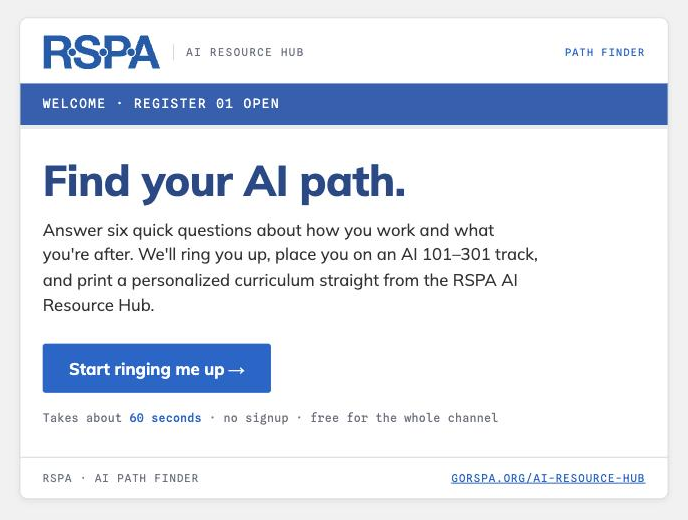
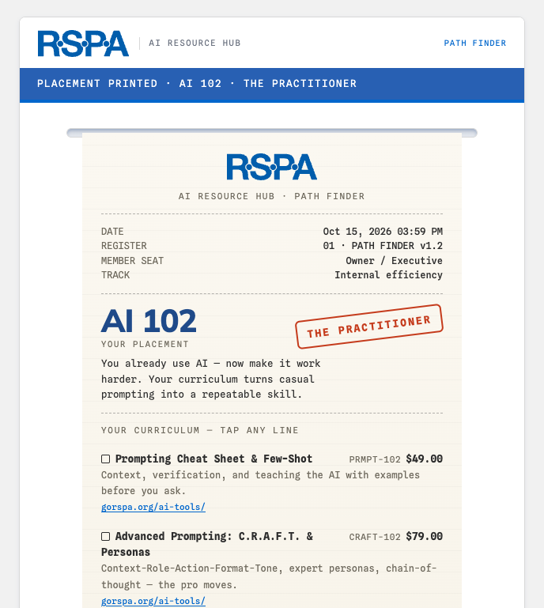
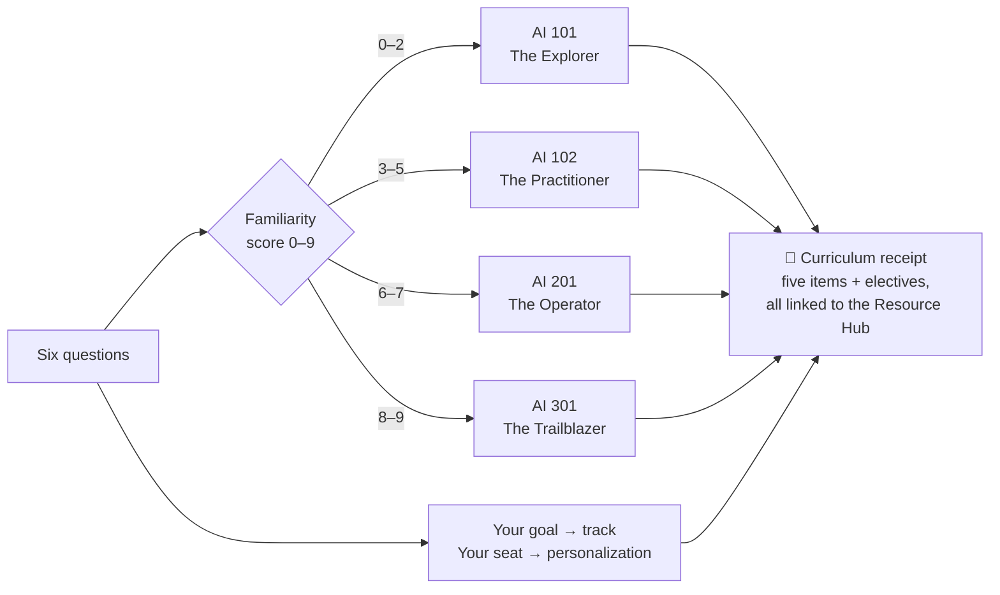

# AI Path Finder

**Six quick questions. One personalized AI curriculum — printed as a receipt.**

A free tool for the [RSPA AI Resource Hub](https://www.gorspa.org/ai-resource-hub/), built for VARs, ISVs, vendors, and distributors.

   

 

<table>
<tr>
<td align="center" width="50%"> Answer six questions — by mouse, touch, or the A–D keys</td>
<td align="center" width="50%"> …and your curriculum prints as a receipt you can share</td>
</tr>
</table>

## What is this?

Wondering where to start with AI — or what to read next? The AI Path Finder asks six quick questions about how you work and what you're after: your hands-on experience, a (painless) vocabulary check, the seat you sit in, your goal, your company's AI maturity, and what's holding you back. Then it rings you up and **prints your placement as a point-of-sale receipt**: a level, a persona, and a five-item reading path drawn from the RSPA AI Resource Hub — every line tappable, every link a real RSPA resource.

There's no signup, nothing is collected or stored, and it takes about a minute. Your result comes with a shareable link, a pre-written LinkedIn post, and a drafted email — so a team lead can send it to the whole shop and compare receipts.

## How the placement works

Three questions measure familiarity from different angles (what you claim, what you can define, and how your company operates), the last question honestly nudges borderline scores, and the other two decide *what's on your receipt* rather than how advanced it is:

| Placement | Who lands here | Your receipt focuses on |
|---|---|---|
| **AI 101 · The Explorer** | Starting fresh — and in the best spot to build it right | Terminology, myth-busting, first prompts, one action for this week |
| **AI 102 · The Practitioner** | Already using AI, ready for better results | Advanced prompting (C.R.A.F.T., personas), protecting your IP |
| **AI 201 · The Operator** | Putting AI to work across the business | Team-by-team internal use cases, governance, the reseller playbook |
| **AI 301 · The Trailblazer** | Bringing AI to merchants and products | Merchant-facing AI by vertical, AI & payments, the AI Advisory Group |

The complete decision flow — every question, option, point value, and elective rule — is diagrammed in [docs/placement-logic.md](docs/placement-logic.md).

## Try it

**[▶ Take the quiz](https://edcrottydcap.github.io/RSPA-AI-Path-Finder/)** — live from this repo via GitHub Pages. Or download [`index.html`](index.html) (the entire tool is that one file) and open it in any browser.

Got a placement you disagree with, a resource that belongs on a receipt, or an idea for a new track? [Open an issue](../../issues) — or email the RSPA at **Membership@GoRSPA.org** to get involved with the AI Resource Hub itself.

## For maintainers & the curious

| Doc | What's inside |
|---|---|
| [Placement logic](docs/placement-logic.md) | The full decision flow as Mermaid diagrams, and why it's built that way |
| [How it was built](docs/how-it-was-built.md) | Architecture, RSPA-brand design decisions, accessibility, QA |
| [WordPress embed guide](docs/wordpress-embed.md) | Three ways to put it on gorspa.org (a ten-line iframe does it) |
| [Customization](docs/customization.md) | Editing questions, curriculum links, share targets, optional response counter |
| [Content maintenance](docs/content-maintenance.md) | `scripts/audit-content.mjs` link audit + an AI maintainer prompt |
| [Full flow spec](docs/flow-spec.md) | Every question, score threshold, and curriculum URL |

The widget is a single self-contained HTML file: no framework, no build step, no backend, no cookies. It's styled to the RSPA site's own palette and typography, honors reduced-motion and keyboard-only use, and auto-resizes when embedded in an iframe. All curriculum links point to RSPA-published content on gorspa.org; a [Claude artifact preview](https://claude.ai/code/artifact/5fded164-407c-409f-abd7-189eb3e8c3a5) also exists for Datacap-internal review.

---

Maintained by <a href="https://github.com/edcrottydcap">Ed Crotty</a> · Contributions by issue — the repo is read-only for everyone else for now. 
<b>*** THANK YOU FOR LEARNING WITH RSPA · NO REFUNDS ON KNOWLEDGE ***</b>

