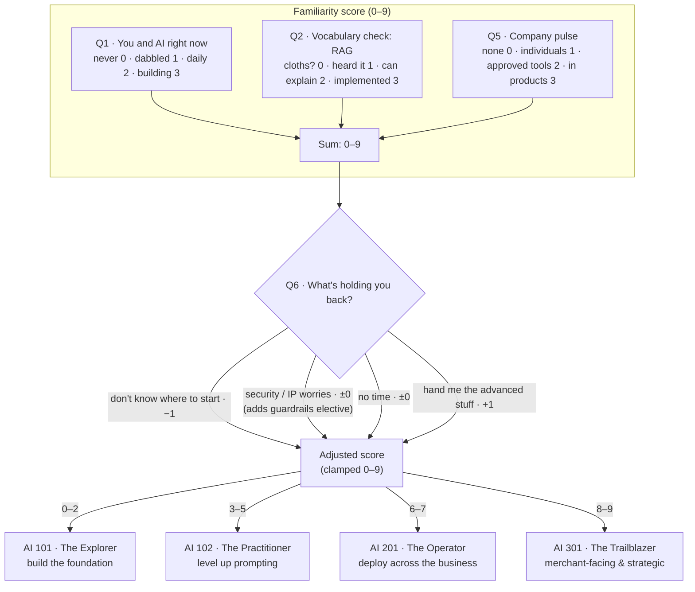
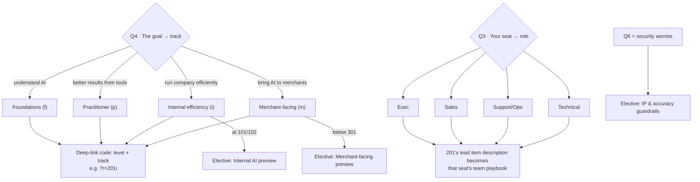

# Placement logic

How six answers become a placement, a persona, and a curriculum. Three questions measure familiarity, one sets the track, one sets the seat, and one nudges the result — everything else is a lookup.

## The full decision flow

## Personalization on top of the level

## The curriculum lookup

Each level maps to five fixed items (see [flow-spec.md](flow-spec.md) for every title, description, and URL):

| Level | Persona | Curriculum spine |
|---|---|---|
| **AI 101** | The Explorer | Terminology → Misconceptions → Basic prompting → Podcast ep. 151 → "one tool, one task" action |
| **AI 102** | The Practitioner | Cheat sheet & few-shot → C.R.A.F.T. & personas → Protect your IP → Inspire decks → Podcast ep. 153 |
| **AI 201** | The Operator | Internal AI by team (role-personalized) → Top 10 Use Cases PDF → Exec application PDF → Governance guardrails → Podcast ep. 153 |
| **AI 301** | The Trailblazer | Merchant-facing AI by vertical → Podcast ep. 159 (AI & payments) → Voice AI / Predictive decks → Pipeline intelligence → Join the AI Advisory Group |

Electives are appended after the spine and deduped against it, so a receipt never lists the same resource twice.

## Why these three questions score and the others don't

Q1 (self-report), Q2 (a concrete vocabulary probe), and Q5 (organizational maturity) triangulate *familiarity* from three different angles — personal claim, verifiable knowledge, and environment — which keeps any one inflated answer from overplacing someone. Q4 and Q3 are preferences, not abilities, so they steer *what* the curriculum contains rather than *how advanced* it is. Q6 is the honesty valve: "I don't know where to start" pulls a borderline score down into a gentler placement, and "hand me the advanced stuff" grants the benefit of the doubt upward — each by exactly one point, so self-perception tunes but never overrides the measured score.
