# The WordPress plugin

The **RSPA AI Path Finder** plugin puts the quiz on any WordPress site in about ten minutes, with no coding. By default the quiz opens in a **popup** over the page, so it never has to fit into an existing layout. That includes the custom page templates the gorspa.org AI Resource Hub uses.

<p align="center">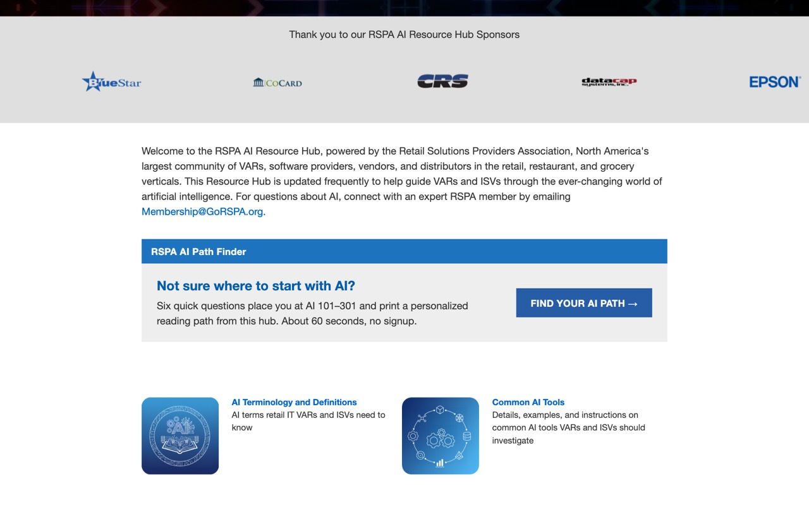<br><sub>Mockup: a copy of the live AI Resource Hub home page with the plugin's card added. The card reuses the hub's own section bar, gray panel, and button style.</sub></p>

---

## 1. Download

**[⬇ Download rspa-ai-path-finder.zip](https://github.com/edcrottydcap/RSPA-AI-Path-Finder/releases/latest/download/rspa-ai-path-finder.zip)** (always the newest release)

Don't unzip it. WordPress installs the zip as-is.

> Building it yourself instead: `node scripts/build-plugin.mjs` writes `dist/rspa-ai-path-finder.zip`. See [Releasing a new version](#releasing-a-new-version).

## 2. Install and activate

You need a WordPress Administrator login.

1. **Plugins → Add Plugin → Upload Plugin** (older WordPress versions say "Add New").
2. Choose `rspa-ai-path-finder.zip` → **Install Now** → **Activate**.

| Upload | Activated |
|---|---|
| 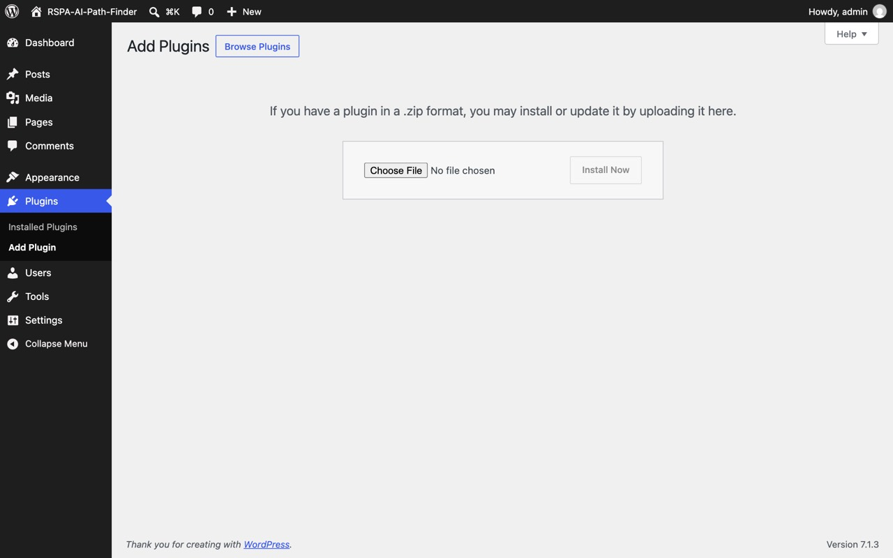 | 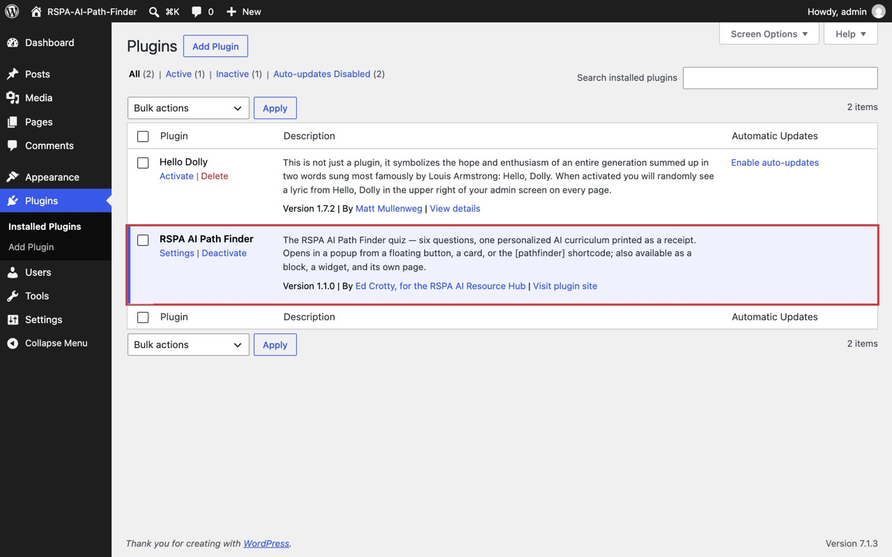 |

The quiz is now live at **`yoursite.org/ai-path-finder/`**. Nothing else on the site has changed.

## 3. Choose how it appears

Pick any one. They can be mixed, and none of them is permanent.

### A. Floating button: easiest, no page editing

**Settings → AI Path Finder → Floating button**: tick **Show the floating button** and **Save Changes**. A "Find your AI path" button appears in the corner of the listed pages and opens the quiz in a popup. The list comes pre-filled with the seven AI Resource Hub pages:

```
/ai-resource-hub/
/ai-terminology/
/ai-tools/
/ai-internal-applications/
/ai-merchant-facing-applications/
/ai-misconceptions-best-practices/
/rspa-ai-education-content/
```

Use one page address per line (full URLs work too), or `*` for every page. This option is printed from the site footer, so it works with **any** theme or page template. **Position** puts it bottom right (default), bottom left, bottom center, top right, or top left.

**It becomes a progress tracker.** Once a visitor has taken the quiz, the button turns into their path, e.g. "AI 201 path · 2 of 7" with a progress ring. Clicking it opens a panel with the checklist from their receipt, a **Next up** link to the first resource they haven't opened, and encouragement ("Nice start! 5 to go", "Halfway there", "One more…", "Path complete!"). Any page on their path that they visit, by any route, is ticked off with a brief "✓ Picked up" note. Turn this off with **Progress tracker** in the settings to keep a plain button.

| The panel | Ticking off a page |
|---|---|
| 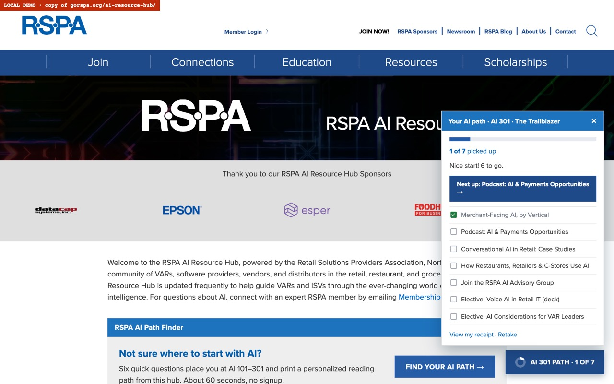 | 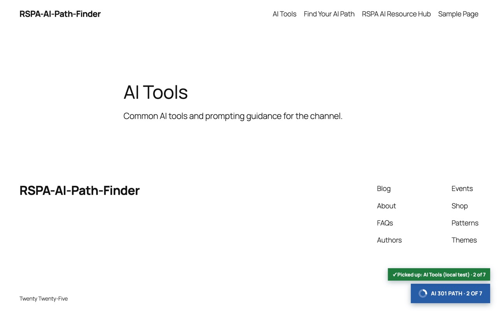 |

| The setting | On the page (mockup) |
|---|---|
| 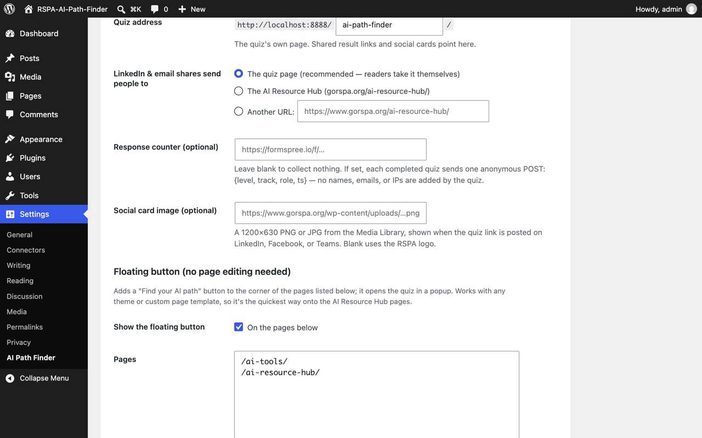 | 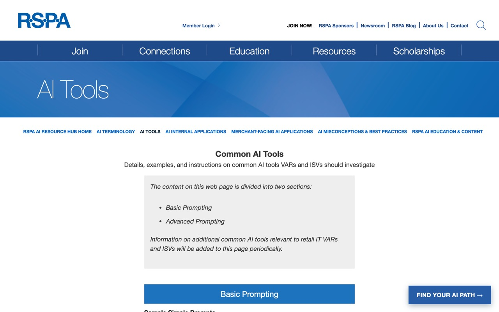 |

### B. The card, inside a page: recommended for the hub home page

Paste this where the card should go (for example, under the hub's welcome text):

```
[pathfinder display="card"]
```

Or, in the block editor, click **+** and search **AI Path Finder**, then choose **Promo card** in the right sidebar. You can edit the heading, text, and button wording there.

| Block inserter | Block options |
|---|---|
| 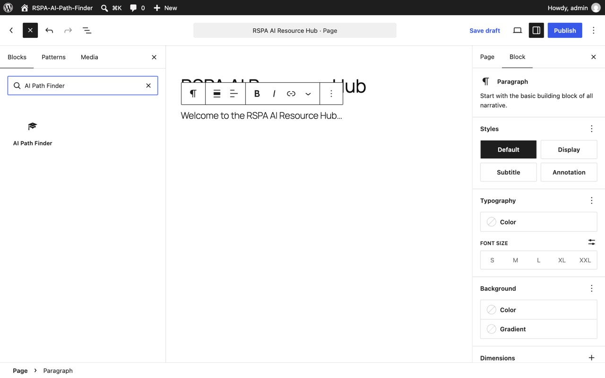 | 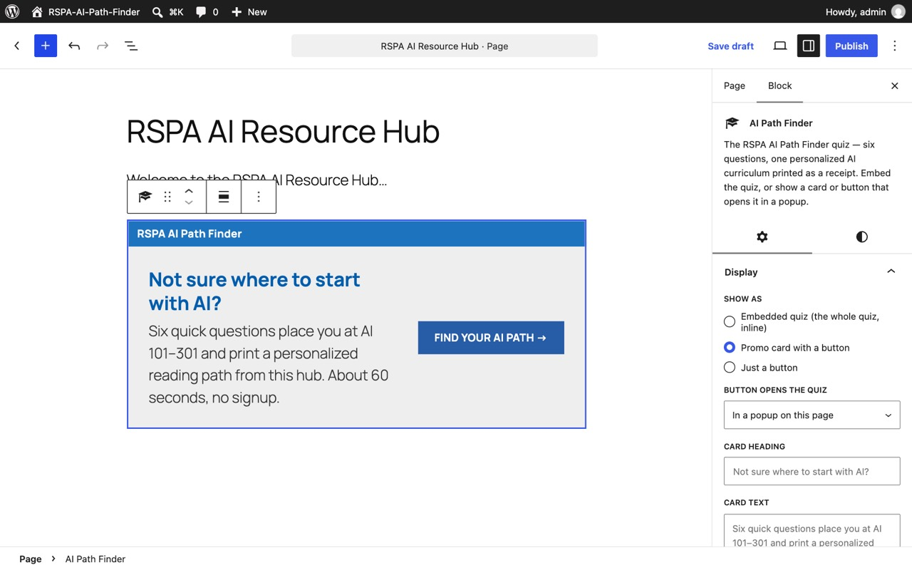 |

### C. Other ways

| You want | Use |
|---|---|
| Just a button that opens the popup | `[pathfinder display="button"]` |
| The whole quiz directly on the page | `[pathfinder]` (it grows as the receipt prints; no inner scroll bars) |
| A menu item, email, social post, or QR code | Link to `yoursite.org/ai-path-finder/` |
| A sidebar | Appearance → Widgets → "AI Path Finder" block, or the "RSPA AI Path Finder" classic widget |
| A custom page template that ignores page content | Template tag below |

<p align="center">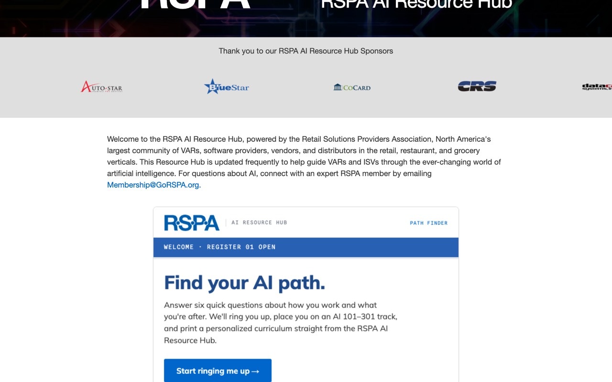<br><sub>Mockup: <code>[pathfinder]</code> puts the full quiz inline.</sub></p>

## 4. Check it

Take the quiz once on a computer and once on a phone, from a private window.

<p align="center">
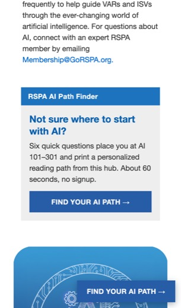
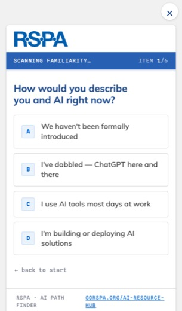
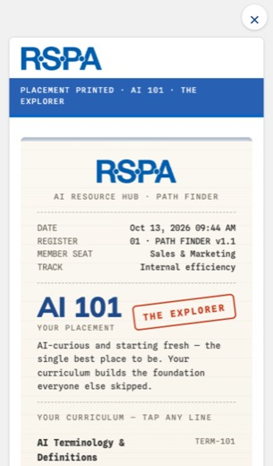
</p>

---

## Settings reference

**Settings → AI Path Finder.** Every setting is optional.

<p align="center">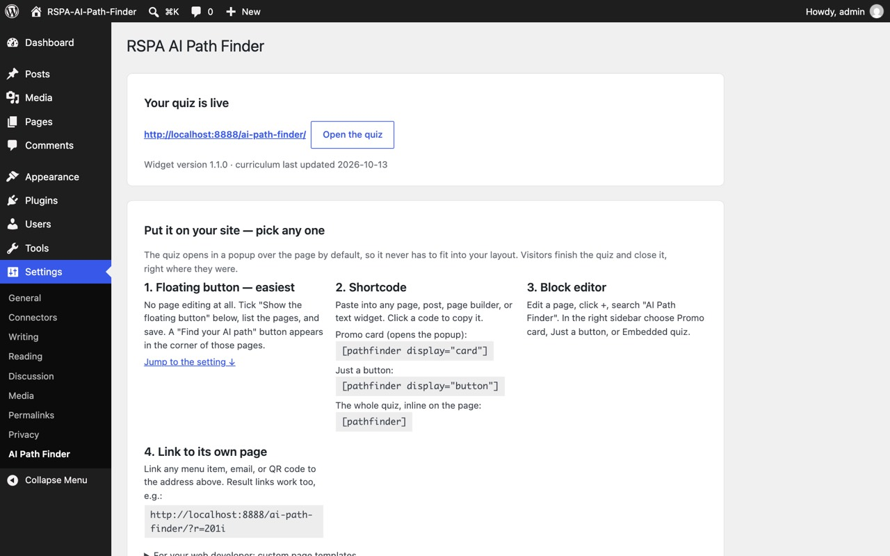</p>

| Setting | What it does | Default |
|---|---|---|
| Quiz address | The quiz's own page; shared result links and social cards point here | `ai-path-finder` |
| Shares send people to | Target of the quiz's LinkedIn and email buttons | The quiz page |
| Response counter | Optional endpoint (Formspree, Google Apps Script). Each finished quiz POSTs `{level, track, role, ts}`; nothing personal | Off |
| Coupon code | Printed on every receipt: the resources' total value, then this code takes 100% off | `PATHFINDER` |
| Social card image | 1200×630 image for LinkedIn/Teams/Facebook link previews | RSPA logo |
| Floating button | On/off, which pages, wording, position (5 choices) | Off · AI hub pages pre-filled · bottom right |
| Progress tracker | After the quiz, the floating button shows the visitor's path and ticks off visited pages | On |

The page also shows the widget version, the curriculum date, copy-ready shortcodes, and a live preview (preview runs are never counted).

## Shortcode reference

`[pathfinder]`, `[PATHFINDER]` and `[rspa_ai_path_finder]` are interchangeable.

| Attribute | Values | Default |
|---|---|---|
| `display` | `embed` (whole quiz inline) · `card` · `button` | `embed` |
| `open` | `popup` · `page` (navigate to the quiz page) | `popup` |
| `text` | Button label | "Find your AI path →" |
| `heading`, `blurb` | Card wording | See the block placeholder |
| `new_tab` | `yes` to open the quiz page in a new tab (with `open="page"`) | `no` |
| `height` | Starting height of the inline quiz, before it measures itself | `640` |
| `class` | Extra CSS class on the wrapper | |

## Template tag (for theme developers)

The gorspa.org AI pages use custom templates (`page-rspa-ai.php`, `page-rspa-ai-sub-v2.php`). If a template doesn't print the editor content, a shortcode in the page won't show. Use the floating button, or add the tag to the template:

```php
<?php if ( function_exists( 'rspa_ai_path_finder' ) ) { rspa_ai_path_finder( array( 'display' => 'card' ) ); } ?>
```

It takes the same keys as the shortcode (`display`, `open`, `text`, `heading`, `blurb`, `new_tab`, `min_height`, `class`).

## Troubleshooting

| Symptom | Fix |
|---|---|
| `/ai-path-finder/` shows "Page not found" | **Settings → Permalinks → Save Changes** (no edits needed) to rebuild WordPress's address rules |
| A change doesn't show on the live site | Clear the host's page cache (gorspa.org is on Flywheel) or the caching plugin's cache |
| Shortcode shows nothing | The page template doesn't print page content. Use the floating button or the template tag |
| A page already uses `/ai-path-finder/` | The settings page warns you; change **Quiz address** |
| The quiz shows a white box | A security plugin is sending `X-Frame-Options: DENY`. Allow `SAMEORIGIN` (the quiz frame is same-site) |

## How it works

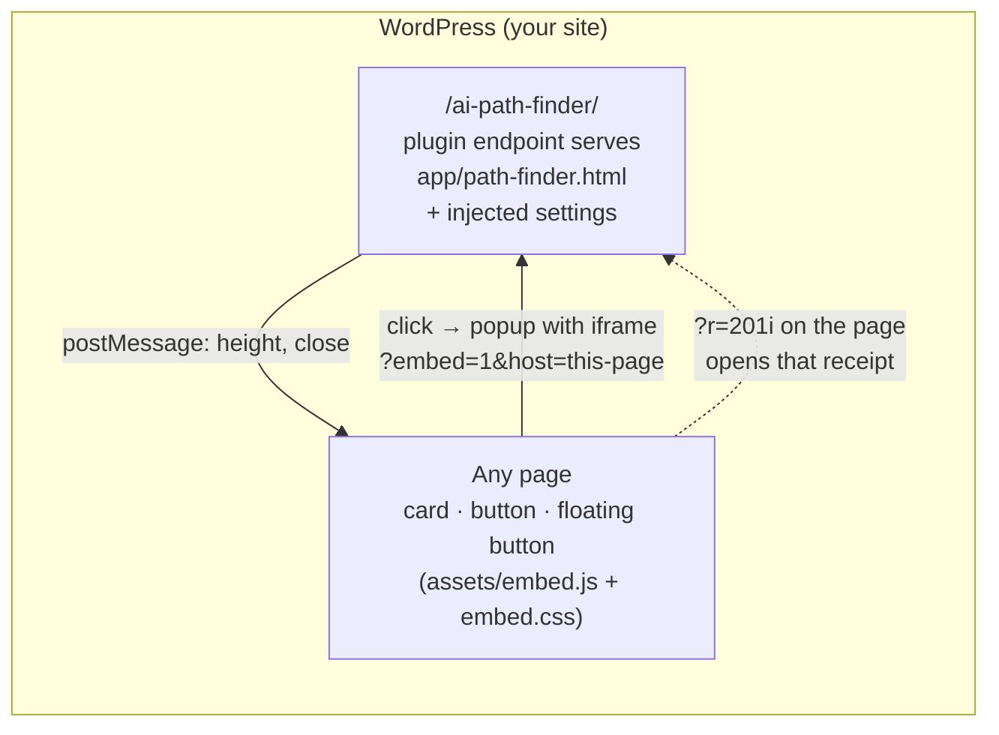

- **One source of truth.** The quiz is the repo's `index.html`; `scripts/build-plugin.mjs` copies it into the plugin as `app/path-finder.html`. The plugin injects `window.RSPA_PATHFINDER_CONFIG` (share target, response counter, result-link base) and the canonical/OG URLs. It never edits the quiz itself.
- **Isolated.** The quiz runs in a same-site iframe, so theme CSS can't touch it and it can't touch the theme. Host-page styles are all under `.rspa-apf`.
- **Auto-sizing.** The quiz posts its height to the host page, so the iframe grows and shrinks with it. Several quizzes on one page are matched by the sending window.
- **Result links come home.** "Copy my result link" points at the page the visitor was on (`?r=201i`). Opening it pops that receipt open, whether the page has an inline quiz, a card, a button, or only the floating button. The `host` parameter is validated against the site's own domain.
- **Phone-safe.** On phones the popup goes full screen. If a theme's layout overflows the screen (the gorspa.org hub home page's header does), the floating button and popup pin themselves to the visible screen via `visualViewport`.
- **Progress stays on the visitor's device.** The receipt's checkmarks and the visitor's path live in the site's `localStorage` (keys `rspa-pathfinder-picked-up` and `rspa-pathfinder-path`). The quiz frame is served from the same site, so the host page's floating button reads the same keys. Nothing is sent anywhere, and there are no cookies. Receipt lines tick when opened; hub pages also tick when visited, if they're on the same site as the plugin.
- **Private by default.** Nothing leaves the browser unless you set a response counter.

Plugin files:

```
wordpress-plugin/rspa-ai-path-finder/
├── rspa-ai-path-finder.php     bootstrap, constants, activation
├── includes/endpoint.php       /ai-path-finder/ route; serves the quiz with settings injected
├── includes/embed.php          block, [pathfinder] shortcodes, template tag, floating button, renderer
├── includes/settings.php       Settings → AI Path Finder
├── includes/widget.php         classic widget
├── blocks/path-finder/         block.json + editor script (plain JS, no build step)
├── assets/embed.js|css         host-page popup, auto-height, progress tracker, phone fixes, hub-matched styles
├── app/path-finder.html        copy of index.html (generated, don't edit by hand)
├── readme.txt                  WordPress-format readme
└── uninstall.php               removes settings on delete
```

## Releasing a new version

1. Edit `index.html` (content or behavior). Bump `rspa-pathfinder-version` and `rspa-pathfinder-content-date` in its `<head>`.
2. `node scripts/build-plugin.mjs`. This copies the quiz into the plugin, syncs the version into the plugin header, `block.json` and `readme.txt`, and builds `dist/rspa-ai-path-finder.zip`.
3. Commit, then tag: `git tag v1.2.0 && git push --tags`. The **Plugin** GitHub Action builds the zip and attaches it to a GitHub Release, which is what the download link above serves.
4. On the WordPress site: upload the new zip and choose **Replace current with uploaded**. Settings are kept.

## Developing locally

Requires Docker.

```bash
npx @wordpress/env start     # WordPress at http://localhost:8888 (admin / password), plugin mounted live
node scripts/build-plugin.mjs   # after editing index.html
npx @wordpress/env stop
```

`.wp-env.json` mounts `wordpress-plugin/rspa-ai-path-finder` and turns on pretty permalinks.
